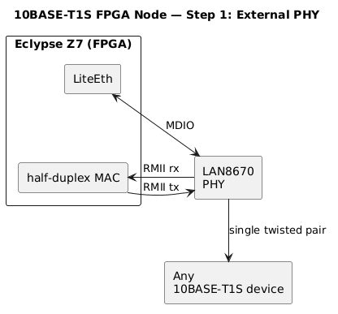
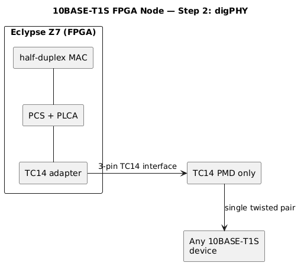

# 10BASE-T1S bringup

**Plan to attach IEEE 802.3cg 10BASE-T1S to the same Arty A7-100T LiteX SoC that already runs CAN and lab Ethernet.**

10BASE-T1S is a 10 Mb/s half-duplex mixing segment on one twisted pair. Nodes share the pair. PLCA (Physical Layer Collision Avoidance) grants transmit turns so the bus stays deterministic. That is the 10 Mb/s automotive backbone drawn on the [Introduction](title-page.md).

The Arty onboard PHY on J9 remains 100/1000BASE-T for TFTP and lab IP. This chapter is the second Ethernet: RMII to a LAN8670 PMOD on **JB**.

This page is a bring-up plan. A working LiteEth 10BASE-T1S bitstream, MDIO init and a measured link are still open. The Step 0 module is on an engineering fabrication hold.

## Hardware

Fit the Step 0 LAN8670 PMOD on JB. Pin map, clock, reset, MDIO header J3 and termination jumpers are on [Hardware PMODs](Hardware-PMODs.md).

```
FPGA (LiteX)
  ├── LiteEthPHYRMII
  ├── LiteEthPHYMDIO
  └── software that writes PLCA registers
         │
         └── RMII + MDIO → LAN8670 PMOD (JB + J3)
                │
                └── 2-pin screw terminal → 10BASE-T1S pair
```



MODE1 is pulled up and MODE0 pulled down, so the PHY is in RMII. The 50 MHz oscillator on the module drives the PHY and JB pin 1. PHYAD[4:0] are pulled down (address 0).

## LiteX / LiteEth work

[LiteEth](https://github.com/enjoy-digital/liteeth) already has `LiteEthPHYRMII` and MDIO. The Arty platform file needs a second Ethernet instance on JB:

1. Map RMII to the JB pins in the table on [Hardware PMODs](Hardware-PMODs.md).
2. Treat CLK50 as an FPGA input clock, with a 20 ns period constraint and RMII input/output delays for the whole Arty plus module path.
3. Drive RST_N from an FPGA output. Hold TXEN inactive until reset is released.
4. Add MDC and MDIO on two spare GPIOs to module header J3.
5. Keep the existing J9 MAC for TFTP. The LAN8670 is a second interface.

Revision 0.2 uses the Arty-specific JB order (CLK50 on pin 1). Copying an older Katze/LiteX RMII pinout will swap the clock and TXD0.

Half-duplex 10BASE-T1S with PLCA is extra work on top of a generic RMII 100 Mb/s PHY. After reset, software writes the PLCA registers over MDIO (node ID, beacon, transmit opportunity). The PHY address is 0; the PLCA node ID is that register, not the PHY address.

Linux later sees this port as a second `eth` device. SocketCAN stays on `can0` from CTUCAN.

## Later: digital PHY

Once the external PHY path works, Step 2 moves Clause 147 PCS and Clause 148 PLCA into FPGA RTL and talks to a small analog PMD over the OPEN Alliance TC14 3-pin interface.



That shrinks the cable-side part to a TC14 transceiver such as a TJA1410. It is the same MAC and application wrapper. It is not required for the first JB bring-up.

## Open items

- LiteX platform constraints and a second LiteEth RMII instance on JB
- MDIO GPIO choice for J3
- PLCA register init and a half-duplex MAC configuration
- 50 MHz clock timing closure on the Arty
- Physical mating, U2 clock qualification and the rest of the Step 0 fabrication hold

Do not tick the automotive-Ethernet box on the introduction until a board is up and packets move on the pair.
