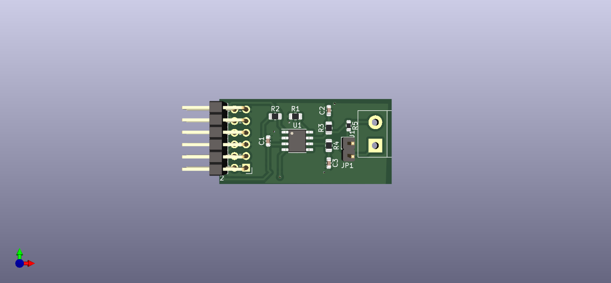
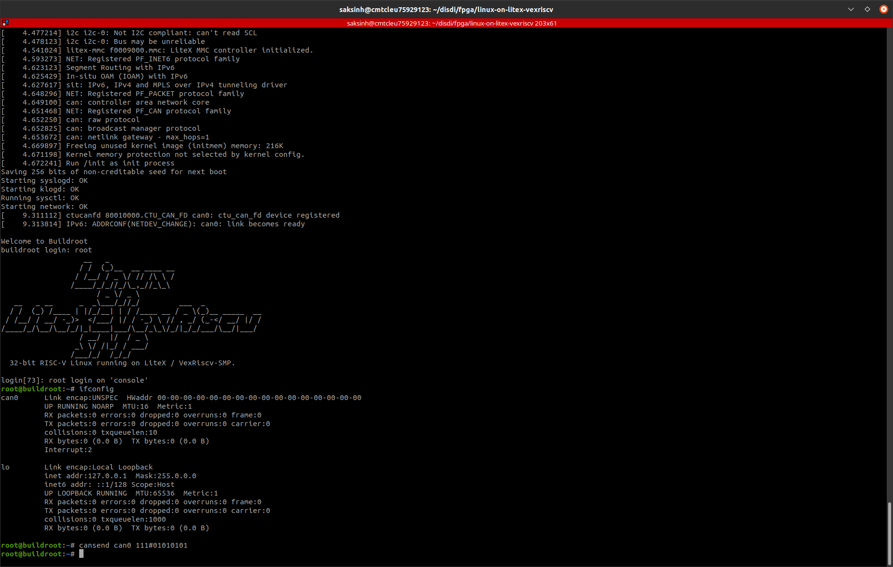

# Communication with CAN devices

**Steps to bringup CAN communication on a 32-bit RISC-V CPU on Xilinx FPGA board Arty A7-100T.**

* We would need to install a handful of very useful CANbus utilities for linux.
This is packaged as can-utils for Linux.

Enable `BR2_PACKAGE_CAN_UTILS=y` in buildroot rootfs.

* We would also need iproute2 package to bringup CAN on Linux where it is treated as a network device.

Enable `BR2_PACKAGE_IPROUTE2=y` in buildroot rootfs.

* Once resulting rootfs is flashed to target, socketcan device can be brought up on Linux with 100 Kbit/s bitrate.

```
ip link set can0 type can bitrate 100000
ip link set up can0
```

* Connect CAN Controller  to CAN Transceiver PMOD

CAN Controller output pins are exposed on PMOD-C(JC) of Arty A7-100T board.
Connect [CAN Transciever PMOD](https://github.com/disdi/canpmod) designed in this project, for easy connection to fpga board over PMOD-C(JC).
The current board, pin map and termination jumper are on [Hardware PMODs](Hardware-PMODs.md).

| PMOD pin | Signal |
| --- | --- |
| 4 | CAN RX (to FPGA) |
| 10 | CAN TX (from FPGA) |
| 5, 11 | GND |
| 6, 12 | 3.3 V from the Arty |
| J1 pin 1 / pin 2 | CAN_L / CAN_H |

Fit JP1 on the module for an end node. Leave it open for a drop node.


The original 3D view is kept for reference:




* Connect a CAN device to other end of CAN Transciever PMOD.

* Communicate between Arty A7-100T and CAN device usinf cansend from can-utils package.


To carry those frames onto lab Ethernet see [Zonal gateway](Zonal-gateway.md). Automotive Ethernet on JB is a separate PHY: [10BASE-T1S bringup](10BASE-T1S-bringup.md).
