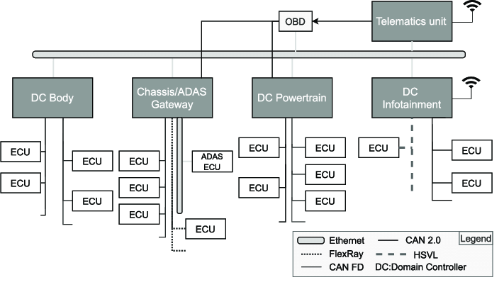
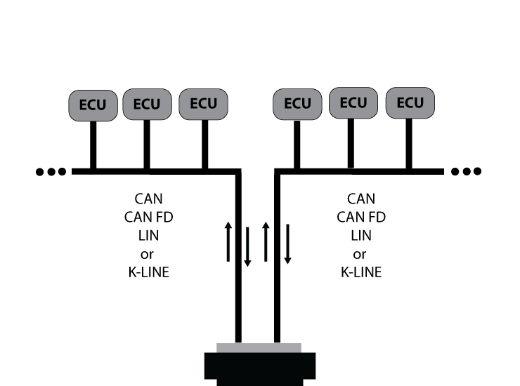

# LibreCar Control Wiki

**Welcome to the LibreCar Control Wiki!**

Current trend in  automotive world is moving towards a zone architecture that classifies ECUs by their physical location inside the vehicle, leveraging a central gateway to manage communication. This physical proximity reduces cabling between ECUs to save space and reduce vehicle weight, while also improving processor speeds.

ECUs with actuators and sensors are connected by lower bandwidth bus of 1Mb/s with CAN and main connection backbone is higher bandwidth of 10Mb/s or 100Mb/s with Automotive Ethernet.

 

LibreCar Control is a automotive exploration tool that can emulate connections inside an automotive vehicle talking between different protocols and buses.

It can be used to:

- [x] Send and Receive CANbus data from any low cost fpga inside a vehicle.
 

- [x] Send and Receive Ethernet packets from the Arty onboard PHY (J9) for lab and TFTP use.

- [x] Act as a CAN-Ethernet Gateway on that lab network, carrying CAN frames over IP with [cannelloni](https://github.com/mguentner/cannelloni). See [Milestone 4](https://librecar.dev/2024/04/milestone-four-complete/).

- [ ] Send and Receive Automotive Ethernet (IEEE 802.3cg 10BASE-T1S) from the same FPGA, using the Step 0 LAN8670 PMOD on JB.

- [ ] Act as a CAN–10BASE-T1S zonal gateway, with CAN on JC and the 10 Mb/s mixing segment on JB.

We use [LiteX SoC builder framework](https://github.com/enjoy-digital/litex) to provide a RISC-V soft processor core and integrate with it peripherals like CAN and Ethernet used in automotive world.

## Hardware on this Arty

The host for these pages is a Digilent Arty A7-100T.

| Connector | Role |
| --- | --- |
| J10 | USB power, console and programming |
| J9 | Onboard Ethernet PHY: Linux TFTP and lab IP |
| JC (PMOD-C) | [CAN transceiver PMOD](https://github.com/disdi/canpmod) |
| JB (PMOD-B) | [10BASE-T1S PMOD](https://github.com/disdi/open-single-pair-ethernet), revision 0.2 |

The two PMODs and the onboard PHY can sit on the board together. JB is also used by the VexRiscv SWD debug work; run 10BASE-T1S or SWD on that header, one at a time.

Pin maps, termination and mating notes are on [Hardware PMODs](Hardware-PMODs.md). CAN bring-up stays on [CAN communication](Communication-with-CAN-devices.md). The automotive Ethernet path is on [10BASE-T1S bringup](10BASE-T1S-bringup.md). Putting both buses on one SoC is [Zonal gateway](Zonal-gateway.md).

The Step 0 LAN8670 module is designed and routed. LiteEth RMII/PLCA integration and a working 10BASE-T1S link remain open.

Roadmap and schematic notes live in [Open Single Pair Ethernet](http://saketsinha.de/open-single-pair-ethernet/).
